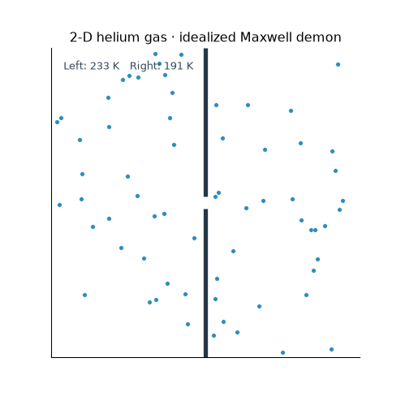
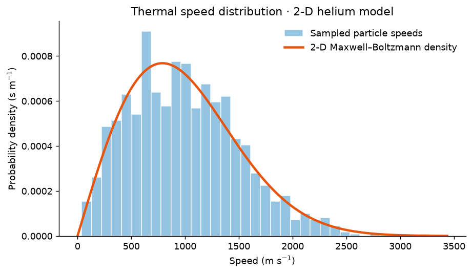
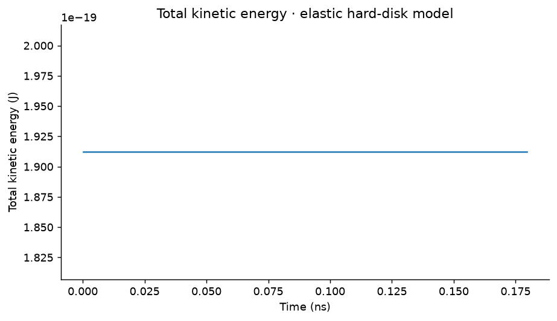
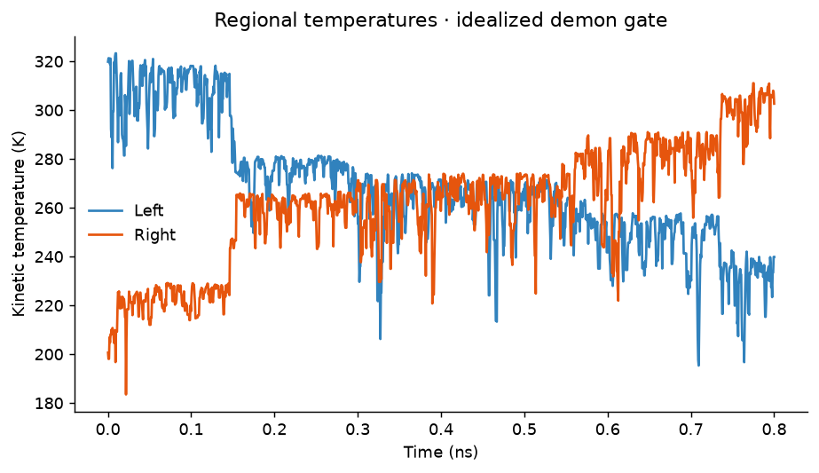

# 2D Helium Gas & Maxwell's Demon

**A particle simulation of elastic collisions, thermal motion, and an idealized Maxwell's demon gate.**

**First-year final project · Introduction to Computer-Based Physical Modeling · International Physics Studies Program (IPSP), Leipzig University**

This project began as my **2024 course submission**. I later revisited the numerical model, fixed collision and boundary-handling problems, added regression tests, and made the experiment reproducible for my programming and computational-physics portfolio. The updated model is **not** the original submission or a peer-reviewed research simulation.

## Simulation preview



[Open the animation at full size](assets/simulation.gif) · [View the simulation source](helium_demon.py) · [View the animation generator](scripts/generate_artifacts.py)

The particles are colored by speed, with the scale at the right. The gold opening marks the selective gate, and the labels above the chambers show their current kinetic temperatures.

The loop has **150 frames at 12.5 FPS** (12 seconds) and advances **2 simulation steps per frame**. Every frame shows the model's actual state after those steps; particles are not interpolated between states. The GIF is a visualization, so its playback clock is not a physical time scale. The generator checks particle bounds, overlaps, motion, and total kinetic-energy drift as it renders.

## Physics and methods

The model uses equal-mass hard disks in a two-dimensional box:

- **Elastic collisions:** particle–particle impacts conserve kinetic energy and momentum in the idealized model.
- **Walls and aperture:** outer boundaries reflect particles; a central divider permits or rejects attempted crossings.
- **Maxwell's demon:** a simplified speed-dependent gate allows fast particles left-to-right and slow particles right-to-left. The demon's information-processing and reset costs are **not** modeled.
- **Two-dimensional thermal statistics:** velocities are sampled from Gaussian components, giving the Maxwell–Boltzmann (Rayleigh) *speed* distribution in 2D:

$$
f(v)=\frac{mv}{k_\mathrm{B}T}\exp\!\left(-\frac{mv^2}{2k_\mathrm{B}T}\right),\qquad v\geq 0.
$$

- **Numerics:** adaptive ballistic substeps, neighboring-cell collision candidates, overlap correction, and collision impulses restricted to approaching pairs.

The demon is an educational thought experiment, **not a demonstration that the second law of thermodynamics can be violated**.

## Results and diagnostics

These plots were generated with fixed random seeds by [`scripts/generate_artifacts.py`](scripts/generate_artifacts.py). They illustrate thermal sampling and selected numerical observables, rather than establishing research-grade accuracy.

**1. Thermal speed distribution** — sampled particle speeds compared with the theoretical 2D density.



**2. Kinetic energy** — total kinetic energy over the simulated time interval.



**3. Compartment temperatures** — kinetic-temperature estimates for the left and right sides during an idealized demon-gate simulation.



## Run it on Linux / WSL

```bash
sudo apt update
sudo apt install python3 python3-venv git
git clone https://github.com/abooban/Project-CBPM.git
cd Project-CBPM

python3 -m venv .venv
source .venv/bin/activate
python -m pip install -r requirements.txt

pytest
jupyter lab Project.ipynb
```

Generate fresh plots and the animation with:

```bash
python scripts/generate_artifacts.py
```

The notebook is a lightweight interface to the tested simulation code and intentionally does not embed its original, large saved animations.

## What changed after the coursework submission?

The original 2024 notebook remains accessible through Git history. The later revision:

- Corrected missed collisions between adjacent spatial grid cells and responses to separating particles.
- Added radius-aware boundaries and crossing-based gate logic, addressing particles becoming trapped or repeatedly reflected.
- Corrected the speed-density and temperature equations for a **2D** simulation rather than 3D.
- Separated the numerical model from presentation code and added deterministic tests.

The tests cover conservation in individual collisions, wall reflections, gate behavior, overlap handling, 2D thermal statistics, and bounded long-run stepping. They **do not prove** exact many-particle dynamics or full physical realism.

## Project files

| File | Purpose |
| --- | --- |
| [`Project.ipynb`](Project.ipynb) | Notebook entry point |
| [`helium_demon.py`](helium_demon.py) | Simulation physics and numerical integration |
| [`scripts/generate_artifacts.py`](scripts/generate_artifacts.py) | Reproducible figures and GIF |
| [`tests/test_helium_demon.py`](tests/test_helium_demon.py) | Numerical regression tests |
| [`assets/`](assets/) | Animation and figures |
| [`requirements.txt`](requirements.txt) | Python dependencies |

---

*Completed 2024 university coursework; numerical implementation and documentation subsequently improved for this portfolio.*
