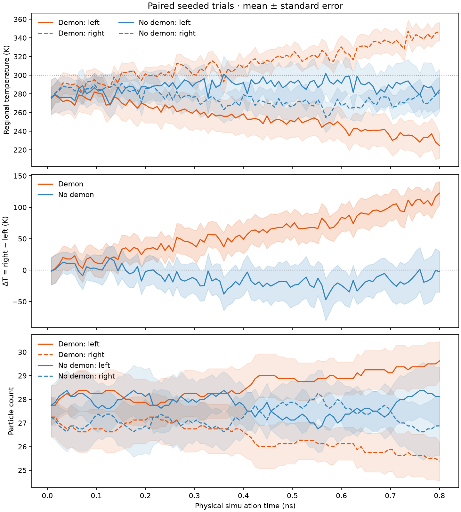

# 2D Helium Gas & Maxwell's Demon

**A particle simulation of elastic collisions, thermal motion, and an idealized Maxwell's demon gate.**

**First-year final project · Introduction to Computer-Based Physical Modeling · International Physics Studies Program (IPSP), Leipzig University**

This project began as my **2024 course submission**. I later revisited the numerical model, fixed collision and boundary-handling problems, added regression tests, and made the experiment reproducible for my programming and computational-physics portfolio. The updated model is **not** the original submission or a peer-reviewed research simulation.

## Simulation preview


[Open the animation at full size](assets/simulation.gif) · [View the simulation source](helium_demon.py) · [View the animation generator](scripts/generate_artifacts.py)

The particles are colored by speed, with the scale at the right. The gold opening marks the selective gate, and the labels above the chambers show their current kinetic temperatures.

The loop has **200 frames at 12.5 FPS** (16 seconds of playback) and advances **20 simulation steps per frame**, covering **0.8 ns** of model time. Playback speed and physical simulation time are separate. Every frame shows the model's actual state after those steps; particles are not interpolated between states. The generator checks particle bounds, overlaps, motion, and total kinetic-energy drift as it renders.

## Physics and methods

The model uses equal-mass hard disks in a two-dimensional box:

- **Elastic collisions:** particle–particle impacts conserve kinetic energy and momentum in the idealized model.
- **Walls and aperture:** outer boundaries reflect particles; a central divider permits or rejects attempted crossings.
- **Maxwell's demon:** a simplified speed-dependent gate allows fast particles left-to-right and slow particles right-to-left. The demon's information-processing and reset costs are **not** modeled.
- **Two-dimensional thermal statistics:** velocities are sampled from Gaussian components, giving the Maxwell–Boltzmann (Rayleigh) *speed* distribution in 2D:

$$
f(v)=\frac{mv}{k_\mathrm{B}T}\exp\!\left(-\frac{mv^2}{2k_\mathrm{B}T}\right),\qquad v\geq 0.
$$

- **Numerics:** adaptive ballistic substeps, neighboring-cell collision candidates, overlap correction, and collision impulses restricted to approaching pairs.

The demon is an educational thought experiment, **not a demonstration that the second law of thermodynamics can be violated**.

## Results and diagnostics

These plots were generated with fixed random seeds. The paired demon/no-demon experiment is produced by [`scripts/analyze_demon.py`](scripts/analyze_demon.py), and the remaining figures by [`scripts/generate_artifacts.py`](scripts/generate_artifacts.py).

**1. Thermal speed distribution** — sampled particle speeds compared with the theoretical 2D density.


**2. Kinetic energy** — total kinetic energy over the simulated time interval.


**3. Compartment temperatures** — one seeded trajectory during an idealized demon-gate simulation.


**4. Paired demon/no-demon experiment** — mean across eight independent initial seeds with standard-error bands. The lower panels show ΔT (right minus left) and counts in both compartments; the CSV records every sample, energy drift, and cumulative crossing decisions classified by direction and speed.



### What the temperature readings show

The earlier animation showed roughly **236 K left and 185 K right** in its first **0.06 ns**. Repeating its seed and frame duration gave **240.3 K left and 188.4 K right**, but inspection found that the old random initializer had placed two particle centers inside the solid divider. The frame also came after only 300 simulation steps and before any accepted gate crossings in the corrected model. The old reading combined invalid starting geometry with noisy, small regional samples and did not test whether sorting had developed. With valid geometry, the same nominal seed starts near **193 K left and 227 K right** and reads **193 K and 234 K** after 0.06 ns, still before any accepted crossings.

To test the gate, eight paired runs used the same 55-particle starting state for each demon/no-demon pair, 4,000 steps at `2e-13 s` per step (0.8 ns), and independent seeds. At the end, mean ΔT was **+122 K with the demon** (across-seed SD 53 K) and **−3 K without it** (SD 92 K). The paired demon-minus-control effect was **+125 K** (SD 104 K; approximate 95% t interval +38 to +212 K). Seven of eight paired differences were positive, and all eight demon runs ended with the right side hotter. The demon runs accepted 27 fast left-to-right and 41 slow right-to-left crossings in total; the remaining attempted crossings were rejected by the speed rule or the narrow aperture. This supports a gate-caused temperature separation despite substantial seed-to-seed variability. The [experiment CSV](assets/demon_experiment.csv) contains the per-seed time histories and decision counts.

Total kinetic energy drift stayed below **2.3×10⁻¹⁵ relative** in all runs. Temperature estimates use the 2-D kinetic definition with each region's center-of-mass drift removed and `2N−2` degrees of freedom. Small and changing compartment populations make instantaneous estimates fluctuate; the time-series figure reports ensemble means and standard errors, and the CSV preserves per-seed counts and traces. This idealized gate does work on the gas by selectively transmitting particles; its information-processing and reset costs are outside the simulation.

## Run it on Linux / WSL

```bash
sudo apt update
sudo apt install python3 python3-venv git
git clone https://github.com/abooban/Project-CBPM.git
cd Project-CBPM

python3 -m venv .venv
source .venv/bin/activate
python -m pip install -r requirements.txt

pytest
jupyter lab Project.ipynb
```

Generate fresh plots and the animation with:

```bash
python scripts/generate_artifacts.py
python scripts/analyze_demon.py
```

The notebook is a lightweight interface to the tested simulation code and intentionally does not embed its original, large saved animations.

## What changed after the coursework submission?

The original 2024 notebook remains accessible through Git history. The later revision:

- Corrected missed collisions between adjacent spatial grid cells and responses to separating particles.
- Added radius-aware boundaries and crossing-based gate logic, addressing particles becoming trapped or repeatedly reflected.
- Prevented invalid initial placement in the solid divider and added finite-radius divider and gate-edge reflections so particles cannot clip through wall corners.
- Corrected the speed-density and temperature equations for a **2D** simulation rather than 3D.
- Separated the numerical model from presentation code and added deterministic tests.

The tests cover conservation in individual collisions, wall reflections, gate behavior, overlap handling, 2D thermal statistics, and bounded long-run stepping. They **do not prove** exact many-particle dynamics or full physical realism.

## Project files

| File | Purpose |
| --- | --- |
| [`Project.ipynb`](Project.ipynb) | Notebook entry point |
| [`helium_demon.py`](helium_demon.py) | Simulation physics and numerical integration |
| [`scripts/generate_artifacts.py`](scripts/generate_artifacts.py) | Reproducible figures and GIF |
| [`tests/test_helium_demon.py`](tests/test_helium_demon.py) | Numerical regression tests |
| [`assets/`](assets/) | Animation and figures |
| [`requirements.txt`](requirements.txt) | Python dependencies |

---

*Completed 2024 university coursework; numerical implementation and documentation subsequently improved for this portfolio.*
